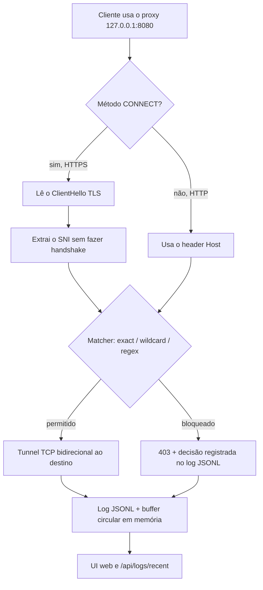

# Whitelist Proxy

[](https://github.com/in100tiva/whitelist-proxy/actions/workflows/ci.yml)
[](https://github.com/in100tiva/whitelist-proxy/actions/workflows/codeql.yml)
[](https://securityscorecards.dev/viewer/?uri=github.com/in100tiva/whitelist-proxy)
[](https://github.com/in100tiva/whitelist-proxy/releases/latest)
[](LICENSE)


> **Em 30 segundos:** um proxy local para Windows que só deixa sair o que está na whitelist. Inspeciona HTTPS pelo SNI (sem MITM e sem instalar certificado nos clientes) e traz UI web + API para operar as regras.

[Como funciona](#como-funciona) · [Instalação](#instalação) · [Editando a whitelist](#editando-a-whitelist) · [Interface web](#interface-web) · [API](#api-administrativa) · [Limitações](#limitações-conhecidas) · [Roadmap](#roadmap) · [Contribuindo](#contribuindo)

Proxy local para Windows escrito em Go que funciona como **whitelist de
domínios**: tudo que não estiver na lista é bloqueado. Inspeção de HTTPS
via SNI (sem MITM, sem certificado raiz instalado nos clientes) e
filtragem de HTTP via header `Host`.

## Como funciona

- Roda como **Windows Service** (`golang.org/x/sys/windows/svc`).
- Configura automaticamente o proxy do sistema no registro (`HKCU\Software\Microsoft\Windows\CurrentVersion\Internet Settings`)
  ao subir e reverte ao parar.
- Escuta em `127.0.0.1:8080` (proxy) e `127.0.0.1:8081` (admin).
- Para **HTTPS** (método `CONNECT`): aceita o `CONNECT`, lê os primeiros
  bytes do `ClientHello` TLS, parseia o SNI manualmente (sem fazer
  handshake), consulta o matcher e — se permitido — abre o tunnel TCP
  bidirecional ao destino real.
- Para **HTTP**: usa o header `Host` e encaminha o request.
- Whitelist em `whitelist.json` ao lado do binário, com hot-reload (watcher
  baseado em `mtime` polling).

### Fluxo de uma requisição



## Instalação

### 1. Baixar a release (recomendado)

Binários pré-compilados ficam na página de
[**Releases**](https://github.com/in100tiva/whitelist-proxy/releases/latest):

| Sistema | Arquitetura | Arquivo |
|---------|-------------|---------|
| Windows | x64 | `proxy-windows-amd64.zip` |
| Windows | arm64 | `proxy-windows-arm64.zip` |
| Linux | x64 / arm64 | `proxy-linux-{amd64,arm64}.tar.gz` |
| macOS | Intel / Apple Silicon | `proxy-darwin-{amd64,arm64}.tar.gz` |

No Windows, baixe o `.zip`, extraia `proxy.exe` e siga
[Instalando como serviço](#instalando-como-serviço).

Os executáveis **não são assinados** com certificado comercial, então o
SmartScreen pode avisar na primeira execução — é esperado. Para conferir a
integridade, use o `SHA256SUMS.txt` da release ou a atestação de procedência:

```powershell
# checksum
Get-FileHash .\proxy-windows-amd64.zip -Algorithm SHA256

# atestação (requer gh CLI autenticado)
gh attestation verify .\proxy-windows-amd64.zip --repo in100tiva/whitelist-proxy
```

### 2. Instalar a partir do código

Pré-requisito: Go 1.26+.

```sh
# direto do código, sem clonar
go install github.com/in100tiva/whitelist-proxy/cmd/proxy@latest
```

Em qualquer plataforma (gera o binário Windows):

```sh
cd whitelist-proxy
GOOS=windows GOARCH=amd64 go build -o proxy.exe ./cmd/proxy
```

No próprio Windows:

```powershell
cd whitelist-proxy
go build -o proxy.exe .\cmd\proxy
```

## Instalando como serviço

1. Abra o **PowerShell como Administrador**.
2. Rode o script de instalação (copia binário + whitelist para `C:\Program Files\WhitelistProxy\`,
   registra o serviço e inicia):

```powershell
cd whitelist-proxy
.\install.ps1
```

3. Confira o estado:

```powershell
& 'C:\Program Files\WhitelistProxy\proxy.exe' status
```

### Subcomandos do binário

```
proxy.exe install     instala como Windows Service (auto-start)
proxy.exe uninstall   remove o serviço
proxy.exe start       inicia o serviço
proxy.exe stop        para o serviço
proxy.exe run         executa em foreground (debug)
proxy.exe status      mostra o estado do serviço e do proxy do sistema
proxy.exe ui          imprime e abre a URL da UI web (com token)
proxy.exe version     mostra a versão do binário
```

## Interface web

O binário traz uma **UI web embutida** servida pelo próprio admin server
em `http://127.0.0.1:8081/`. Não precisa instalar nada além do `proxy.exe`
— o HTML/CSS/JS está embutido via `embed.FS`.

Para abrir:

```powershell
& 'C:\Program Files\WhitelistProxy\proxy.exe' ui
```

O comando imprime uma URL com o token na query (`?t=...`) e tenta abrir o
navegador. Na primeira visita o token fica salvo em `localStorage`, então
nas próximas vezes basta abrir `http://127.0.0.1:8081/`.

A UI tem três abas:

- **Whitelist** — tabela editável (adicionar/remover/editar regras inline)
  com tipos `exact`/`wildcard`/`regex`. Botão **Salvar** persiste no
  `whitelist.json` e aplica imediatamente. Botão **Recarregar do disco**
  pega o que estiver no arquivo (útil se você editou no Notepad).
- **Logs** — tabela das últimas decisões com auto-refresh a cada 3s,
  filtros por ação (allow/block/info) e por host.
- **Status** — endereços, caminhos, regras carregadas, uptime, contadores
  de decisões e um **testador de host** (digite um domínio e veja se ele
  seria permitido — sem precisar acessar de fato).

Todos os subcomandos que mexem no SCM (`install`, `uninstall`, `start`, `stop`)
exigem prompt elevado.

## Editando a whitelist

Arquivo em produção: `C:\Program Files\WhitelistProxy\whitelist.json`.

> O `whitelist.json` da raiz do repositório é apenas um **exemplo**. O arquivo
> real é criado na primeira execução (ou copiado pelo `install.ps1`) e está no
> `.gitignore` — não versione a lista do seu cliente.

```json
{
  "rules": [
    {"pattern": "google.com",     "type": "exact"},
    {"pattern": "*.google.com",   "type": "wildcard", "note": "Google"},
    {"pattern": "*.googleapis.com","type": "wildcard"},
    {"pattern": "github.com",     "type": "exact"},
    {"pattern": "*.github.com",   "type": "wildcard"},
    {"pattern": "^([a-z0-9-]+\\.)?empresa\\.com\\.br$", "type": "regex"}
  ]
}
```

Tipos de regra:

- `exact`     — bate o host exatamente (`google.com` ≠ `www.google.com`).
- `wildcard`  — formato `*.exemplo.com`. Bate qualquer subdomínio **e**
  o domínio raiz (`exemplo.com` também é liberado).
- `regex`     — qualquer regex Go. É aplicada ao host normalizado em
  lowercase, sem porta.

O serviço **detecta mudanças no arquivo automaticamente** (polling de 2s).
Se você precisa de reload imediato:

```powershell
$token = Get-Content 'C:\Program Files\WhitelistProxy\admin.token'
curl.exe -X POST -H "Authorization: Bearer $token" http://127.0.0.1:8081/whitelist/reload
```

## API administrativa

Escuta em `127.0.0.1:8081` (loopback apenas). Autenticação por Bearer token
no header `Authorization: Bearer <token>` **ou** via query string `?t=<token>`
(usada pela UI no link inicial). O token é gerado na primeira execução em
`admin.token` ao lado do binário.

| Método  | Caminho                  | Descrição                                  |
|---------|--------------------------|--------------------------------------------|
| GET     | `/api/whitelist`         | Devolve a lista carregada em memória       |
| PUT     | `/api/whitelist`         | Substitui a lista (body JSON), valida e persiste em disco |
| POST    | `/api/whitelist/reload`  | Recarrega a whitelist do disco             |
| GET     | `/api/logs/recent?n=200` | Últimas N decisões (default 100)           |
| GET     | `/api/status`            | Info do serviço + contadores               |
| POST    | `/api/test?host=X`       | Devolve `{host, allowed}` sem fazer requisição |
| GET     | `/`                      | UI web (HTML/CSS/JS embutidos)             |

Os caminhos legados sem prefixo `/api` continuam funcionando para
compatibilidade (`/whitelist`, `/whitelist/reload`, `/logs/recent`).

## Logs

- JSONL em `<InstallDir>\logs\proxy-YYYY-MM-DD.log`, rotacionados por dia.
- Buffer circular em memória com as últimas 1000 decisões (servido por
  `/logs/recent`).

## Testando localmente

Em foreground (sem precisar instalar como serviço):

```sh
cd whitelist-proxy
go run ./cmd/proxy run
```

Em outro terminal:

```sh
# HTTPS de um domínio fora da whitelist — deve falhar
curl -x http://127.0.0.1:8080 https://exemplo-bloqueado.com

# Domínio da whitelist — deve passar
curl -x http://127.0.0.1:8080 https://www.google.com
```

Lembre que `go run ./cmd/proxy run` em **não-Windows** só sobe o proxy/admin —
a configuração do proxy do sistema (registro do Windows) é no-op.

A suíte automatizada roda sem privilégio e sem rede externa:

```sh
gofmt -l .      # deve sair vazio
go vet ./...
go test ./... -race
```

## Limitações conhecidas

- **DNS over HTTPS / DNS over TLS no navegador.** Se o navegador resolve
  DNS via DoH para um servidor que está na whitelist (ex.: Cloudflare),
  ele pode bypassar o controle por nome — porque o tráfego ainda parece
  ir para `1.1.1.1`. Solução de fase 2: bloquear DoH conhecidos na lista
  ou usar WinDivert para inspecionar resolução.
- **QUIC / HTTP/3 (UDP/443).** Esse proxy só vê TCP. Tráfego QUIC sai
  direto. Mitigação imediata: bloquear UDP/443 no Windows Defender Firewall.
- **Usuário administrador local pode desabilitar o proxy.** Como o
  proxy do sistema é por usuário (HKCU), basta o usuário desmarcar a
  caixa em "Configurações de proxy" para escapar. Solução de fase 2:
  travar via GPO/HKLM, ou interceptar todo o tráfego com WinDivert
  (mesmo sem proxy do sistema configurado).
- **Aplicações que ignoram o proxy do sistema.** Algumas usam
  configurações próprias (ex.: clientes que não obedecem `WPAD`). Vale
  combinar com regras de firewall que só permitam saída via o proxy.
- **IPs literais.** A whitelist é por nome. Acesso direto a IP
  (`https://1.2.3.4`) sem SNI é bloqueado por padrão (sem SNI = sem
  decisão = bloqueia).

## Segurança

- A API e a UI escutam **somente em loopback**; autenticação por token gerado
  localmente em `admin.token`.
- O projeto não faz MITM nem instala certificado raiz: a inspeção é só do SNI.
- Relatos de vulnerabilidade têm canal privado — veja [SECURITY.md](SECURITY.md).
  **Não** abra issue pública para falha de segurança.
- Postura do repositório acompanhada pelo OpenSSF Scorecard, CodeQL e
  Dependabot a cada push.

## Roadmap

O roadmap de fase 2 é acompanhado nas
[issues](https://github.com/in100tiva/whitelist-proxy/issues):

- [ ] Interceptação via **WinDivert** (não depende do proxy do sistema; vê
      todo tráfego TCP/UDP, mesmo de apps que ignoram o WinINet).
- [ ] Política aplicada via **HKLM** + GPO (impede o usuário de desligar).
- [ ] Bloqueio de QUIC (UDP/443) e endpoints de DoH conhecidos.
- [ ] UI mínima (system tray) para inspecionar bloqueios em tempo real.

Tem uma ideia fora dessa lista? Abra uma
[issue de ideia](https://github.com/in100tiva/whitelist-proxy/issues/new?template=feature_request.yml).

## Estrutura do projeto

```
whitelist-proxy/
├── .github/                 # CI, CodeQL, Scorecard, Dependabot, templates
├── go.mod
├── cmd/proxy/
│   ├── main.go              # dispatcher de subcomandos
│   ├── runtime.go           # composição (logger + matcher + watcher + proxy + admin)
│   ├── ui.go                # subcomando "ui" (abre navegador com token)
│   ├── service_windows.go   # integração com Windows Service Manager
│   └── service_other.go     # stubs cross-plataforma
├── internal/
│   ├── proxy/server.go      # servidor proxy HTTP + CONNECT
│   ├── proxy/sni.go         # parser de SNI do ClientHello (TLS 1.0–1.3)
│   ├── proxy/sni_test.go    # testes do parser (gera ClientHello real)
│   ├── filter/matcher.go    # matcher de whitelist (exact/wildcard/regex)
│   ├── filter/matcher_test.go
│   ├── config/config.go     # carrega/recarrega whitelist.json (watcher por mtime)
│   ├── sysproxy/sysproxy.go # interface comum
│   ├── sysproxy/windows.go  # implementação do registro do Windows + WinINet
│   ├── sysproxy/other.go    # stub no-op
│   ├── admin/server.go      # API REST (auth via Bearer token)
│   ├── admin/ui/            # UI web embutida (index.html + style.css + app.js)
│   └── logger/logger.go     # log estruturado JSONL com rotação diária
├── whitelist.json           # exemplo (o real é criado em runtime)
├── install.ps1              # script de instalação
├── CHANGELOG.md
├── SECURITY.md / CONTRIBUTING.md / CODE_OF_CONDUCT.md / SUPPORT.md
└── README.md
```

## Contribuindo

Contribuições são bem-vindas — leia o [CONTRIBUTING.md](CONTRIBUTING.md) e o
[Código de Conduta](CODE_OF_CONDUCT.md). Para dúvidas de uso, use as
[Discussions](https://github.com/in100tiva/whitelist-proxy/discussions); para
bugs, o [template de issue](.github/ISSUE_TEMPLATE/bug_report.yml).

Se este projeto te ajudou, uma ⭐ no repositório ajuda outros a encontrá-lo.

## Licença

[MIT](LICENSE) © Luan Oliveira dos Santos
